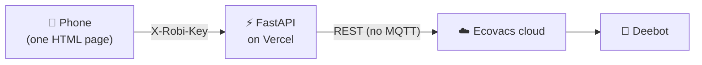

<div align="center">

# 🤖 Robi

**The robot vacuum app your grandma can actually use.**

Tap a room. Tap start. That's it.


</div>

---

## Why this exists

The official ECOVACS HOME app can do *everything*, which is exactly the problem.
A family member who just wants the kitchen vacuumed has to wade through modes,
suction levels, schedules and a "Stop returning" button that strands the robot
in the middle of the hallway. Voice commands stopped working. The map sometimes
shows up rotated. Start goes grey with no explanation while the station empties
the dust bin.

We had a 2-minute WhatsApp video explaining all of this to a relative.
**Robi replaces the video.** It's one phone screen, in plain Croatian, with only
the buttons you need and clear explanations when something goes wrong.

## What it does

| | |
|---|---|
| 🗺️ **Tap rooms on the map** | Your real floor plan, drawn from the robot's saved map. Tap a room (or several), tap **Počni čistiti**. |
| ⏯️ **Only safe buttons** | While cleaning: **Pauza**, **Nastavi**, **Završi i vrati na stanicu**. No "Stop returning", ever. |
| 📡 **Honest status** | Docked, cleaning (with minutes and m²), paused, returning, offline, lost and relocating. Matches the official app. |
| 🛠️ **Errors you can fix** | "The main brush is tangled" becomes a red card with numbered steps in Croatian. Covers ~60 error codes. |
| 🚦 **Station awareness** | Start is locked while the station empties dust or washes mops, and the screen says *why*. |
| 🔋 **Low-battery warning** | So nobody starts a big clean on 12%. |
| 🔐 **One secret link** | No accounts or passwords on the phone. Open a link once, add to Home Screen, done. |

## How it works



- **Stateless backend.** Every request talks to the Ecovacs cloud over REST through
  [`deebot-client`](https://github.com/DeebotUniverse/client.py), the unofficial library behind
  the Home Assistant integration. That makes it a perfect fit for serverless.
- **No password stored.** A one-time login trades your password for an account token. Only the token lives in env vars.
- **Real-world quirks handled.** Some models always report "idle" in the usual status call, so Robi
  reads the true work state instead. Before Resume it checks the robot really is paused, so Resume
  can never accidentally start a whole-house clean. Room outlines are decoded from the compressed
  saved map, so the map still works while the robot is lost.

```
app.py            FastAPI routes, auth, demo robot
robot.py          talks to Ecovacs: status, map, commands
errors.py         ~60 error codes → Croatian title + fix steps
login.py          one-time interactive login → .env.local
public/index.html the whole UI (no build step)
push-env.sh       copy .env.local to Vercel and deploy
```

## Try it in 30 seconds (no robot needed)

```bash
git clone https://github.com/frenki1004/robi && cd robi
ROBI_DEMO=1 uv run app.py
```

Open <http://localhost:8080/#k=demo>. The demo has a fake floor plan.
Pick **Kupaonica** (bathroom) to see what an error looks like.

## Use it with your own Deebot

You need [uv](https://docs.astral.sh/uv/) and an ECOVACS HOME account.

**1. Log in once, on your computer**

```bash
uv run login.py
```

It asks for your email, password and country, then a code Ecovacs emails you.
The password is never saved. It writes `.env.local` with an account token and a random secret key.

**2a. Run at home** (phone on the same Wi-Fi)

```bash
uv run app.py
```

It prints a link. Open it on the phone.

**2b. Or deploy to Vercel** (works from anywhere)

```bash
npx vercel link        # first time only
./push-env.sh
```

It stores the settings as encrypted env vars, deploys, and prints the link for the phone.
Open it once, then **Share → Add to Home Screen**.

To lock out old phones, change `ROBI_KEY` in `.env.local` and run `./push-env.sh` again.

## Good to know

- **Tested on** a Deebot with an auto-empty, mop-washing station (class `4bx3w9`).
  Other models that work with Home Assistant's Ecovacs integration should mostly work too.
  Issues and PRs are welcome.
- **Unofficial.** Ecovacs can change their cloud at any time. If something breaks, update the library first:
  `uv lock --upgrade-package deebot-client`.
- **The UI is in Croatian** 🇭🇷 because that's who it was built for. All the text lives in
  `public/index.html` and `errors.py`, so translating it is easy.

## Ideas on the roadmap

NFC stickers that start a room when you tap your phone on them · push notifications when the robot
is stuck · a live trail on the map · Siri shortcuts · cleaning history.

## License

[MIT](LICENSE). Not affiliated with or endorsed by ECOVACS.
